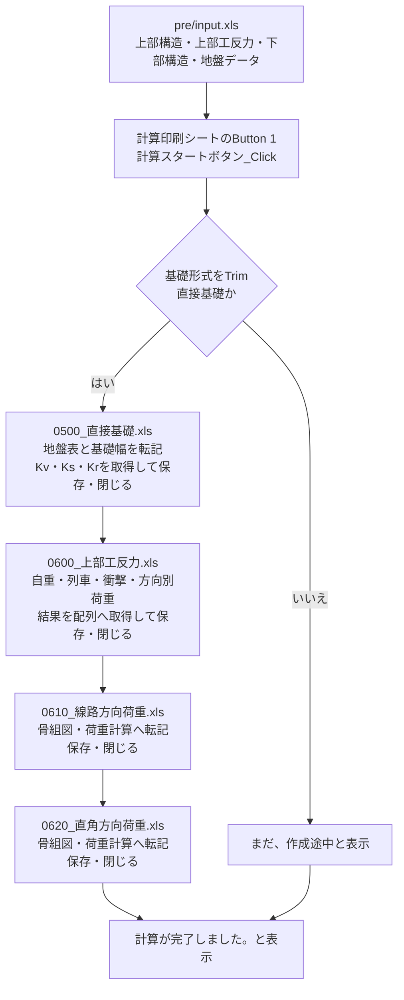

# 橋脚自動設計プログラムの既存サンプル仕様

`pre/input.xls!計算スタートボタン_Click` は、**直接基礎の地盤ばね、上部工反力・橋脚自重、線路方向荷重、直角方向荷重を4冊の計算ブックへ順次反映し、上書き保存する処理**である。柱・フーチングの断面設計や三次元骨組解析まで一括実行する処理は、この入口には接続されていない。

調査日: 2026-10-14。調査対象は同日時点の作業ツリーの10冊の `.xls`。`pre/input.xls` と `0500_直接基礎.xls` には調査開始前からGitとの差分があり、HEADではなく現物を解析した。

## 読む順序

| 文書 | 内容 |
|---|---|
| [01-start-flow.md](01-start-flow.md) | ボタンの割当、実行順、分岐、ファイル更新、副作用、開始・終了イベント |
| [02-data-contracts.md](02-data-contracts.md) | 入力セル、単位、転記先、配列・表の構造、方向別荷重への受渡し |
| [03-calculations.md](03-calculations.md) | 地盤ばね、自重、移動列車、衝撃、方向別荷重と結果表の計算仕様 |
| [04-findings-and-next-design.md](04-findings-and-next-design.md) | 現行の不整合、未実装範囲、新プログラム化で決める事項、検証ケース |
| [05-named-ranges.md](05-named-ranges.md) | 使用する5ブックの業務用定義名363件と実セルの索引 |
| [06-evidence.md](06-evidence.md) | 調査方法、根拠ファイル、検証範囲、再調査方法 |

## 全体のデータフロー

この図はVBAが指定している処理順である。実際の到達にはファイルを開けることなどが必要で、現物にはパスの区切り文字欠落がある。未対応の基礎形式にも「完了」を表示するため、このメッセージだけでは計算成功を判断できない。

## 仕様の確度

- **コード確認**: 抽出したVBAの呼出し、分岐、代入、保存・終了処理。
- **数式確認**: Excelを読み取り専用で開いて取得したセル数式、定義名、ボタン割当。
- **保存値確認**: `.xls` に残っている入力値・結果値。開始マクロを実行した結果ではない。
- **提案・要確認**: 現行の意図を推定した内容や、新プログラムの設計案。既存の動作仕様とは区別する。

マクロの一括実行、外部計算サービスへの送信、設計基準への適合性評価は行っていない。元のExcelファイルは変更していない。現行コード・数式には不整合があるため、保存済みの数値をそのまま新プログラムの正解値にしない。

## ブックの役割と到達範囲

| ブック | 入口からの到達 | 役割・確認内容 |
|---|---|---|
| `pre/input.xls` | 起点 | 入力4シートと計算ボタン。手続き間の結果をPublic変数で保持 |
| `0500_直接基礎.xls` | 1番目 | 地盤表、長期・短期の基礎ばね。VBAなし |
| `0600_上部工反力.xls` | 2番目 | 自重はセル数式、移動荷重探索と図形描画はVBA |
| `0610_線路方向荷重.xls` | 3番目 | 骨組諸元・荷重計算等。VBAなし |
| `0620_直角方向荷重.xls` | 4番目 | 支承ごとの荷重分担・荷重集計等。VBAなし |
| `0510_杭基礎.xls` | 呼出しなし | 同梱されているが杭基礎分岐は未実装 |
| `0612_線路方向柱.xls` | 呼出しなし | 柱用の独立マクロ・外部送信処理が存在 |
| `0700_基礎フーチング.xls` | 呼出しなし | 同梱のフーチング用ブック |
| `0710_杭基礎フーチング.xls` | 呼出しなし | 同梱の杭基礎フーチング用ブック |
| `三次元骨組解析.xls` | 呼出しなし | 独立した骨組解析用マクロ・外部送信処理が存在 |

「呼出しなし」は、この開始マクロから抽出VBAの呼出しを追った結果である。同梱ブック自体が不要、または機能しないという意味ではない。
